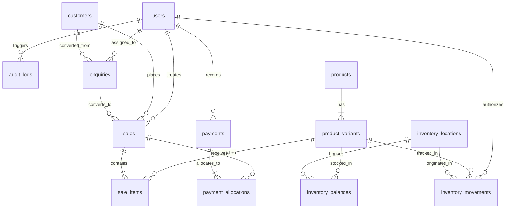

# Fizzora - Relational Database Schema Design

## Database Engine: PostgreSQL 17+ (SQLAlchemy 2.0 ORM)

All monetary fields use fixed-precision `NUMERIC(12, 2)` to avoid IEEE floating-point arithmetic errors. All timestamps use timezone-aware `TIMESTAMPTZ` defaulting to UTC.

---

## Entity Relationship Summary

---

## Table Specifications

### 1. `users`
System administrative and staff accounts.
- `id`: UUID PRIMARY KEY (or Integer BigSerial)
- `name`: VARCHAR(150) NOT NULL
- `email`: VARCHAR(255) UNIQUE NOT NULL (indexed)
- `password_hash`: VARCHAR(255) NOT NULL
- `role`: VARCHAR(50) NOT NULL ('ADMIN', 'STAFF', 'READONLY')
- `is_active`: BOOLEAN NOT NULL DEFAULT TRUE
- `created_at`: TIMESTAMPTZ NOT NULL DEFAULT NOW()
- `updated_at`: TIMESTAMPTZ NOT NULL DEFAULT NOW()

### 2. `products`
Beverage products.
- `id`: INTEGER PRIMARY KEY GENERATED ALWAYS AS IDENTITY
- `name`: VARCHAR(150) NOT NULL
- `slug`: VARCHAR(150) UNIQUE NOT NULL (indexed)
- `description`: TEXT
- `flavour`: VARCHAR(100) NOT NULL (e.g., 'Jeera Masala', 'Lemon Fizz', 'Kachi Keri', 'Cola Fizz')
- `image_url`: VARCHAR(500)
- `is_featured`: BOOLEAN NOT NULL DEFAULT FALSE
- `status`: VARCHAR(50) NOT NULL DEFAULT 'PUBLISHED' ('PUBLISHED', 'DRAFT', 'ARCHIVED')
- `created_at`: TIMESTAMPTZ NOT NULL DEFAULT NOW()
- `updated_at`: TIMESTAMPTZ NOT NULL DEFAULT NOW()

### 3. `product_variants`
Pack sizes, bottle formats, and SKUs.
- `id`: INTEGER PRIMARY KEY GENERATED ALWAYS AS IDENTITY
- `product_id`: INTEGER NOT NULL REFERENCES products(id) ON DELETE CASCADE
- `bottle_size`: VARCHAR(50) NOT NULL (e.g., '200ml', '500ml', '1.25L')
- `sku`: VARCHAR(100) UNIQUE NOT NULL (indexed)
- `mrp`: NUMERIC(10, 2) NOT NULL
- `selling_price`: NUMERIC(10, 2) NOT NULL
- `cost_price`: NUMERIC(10, 2) NOT NULL
- `reorder_threshold`: INTEGER NOT NULL DEFAULT 50
- `is_active`: BOOLEAN NOT NULL DEFAULT TRUE
- `created_at`: TIMESTAMPTZ NOT NULL DEFAULT NOW()

### 4. `customers`
Retailers, Kirana shops, Distributors, or Direct Wholesale Clients.
- `id`: INTEGER PRIMARY KEY GENERATED ALWAYS AS IDENTITY
- `customer_type`: VARCHAR(50) NOT NULL DEFAULT 'RETAILER' ('RETAILER', 'DISTRIBUTOR', 'DIRECT_CONSUMER')
- `business_name`: VARCHAR(200)
- `contact_name`: VARCHAR(150) NOT NULL
- `phone`: VARCHAR(30) NOT NULL (indexed)
- `email`: VARCHAR(255)
- `gstin`: VARCHAR(30)
- `address`: TEXT
- `city`: VARCHAR(100) NOT NULL DEFAULT 'Ahmedabad'
- `state`: VARCHAR(100) NOT NULL DEFAULT 'Gujarat'
- `notes`: TEXT
- `created_at`: TIMESTAMPTZ NOT NULL DEFAULT NOW()
- `updated_at`: TIMESTAMPTZ NOT NULL DEFAULT NOW()

### 5. `enquiries`
Lead generation from website B2B forms, WhatsApp, or field visits.
- `id`: INTEGER PRIMARY KEY GENERATED ALWAYS AS IDENTITY
- `contact_name`: VARCHAR(150) NOT NULL
- `business_name`: VARCHAR(200)
- `phone`: VARCHAR(30) NOT NULL
- `email`: VARCHAR(255)
- `city`: VARCHAR(100) NOT NULL
- `enquiry_type`: VARCHAR(50) NOT NULL DEFAULT 'RETAILER' ('RETAILER', 'DISTRIBUTOR', 'BULK_EVENT', 'OTHER')
- `estimated_demand`: VARCHAR(100)
- `message`: TEXT
- `source_channel`: VARCHAR(50) NOT NULL DEFAULT 'WEBSITE' ('WEBSITE', 'WHATSAPP', 'INSTAGRAM', 'PHONE', 'FIELD')
- `status`: VARCHAR(50) NOT NULL DEFAULT 'NEW' ('NEW', 'CONTACTED', 'QUALIFIED', 'CONVERTED', 'CLOSED', 'SPAM')
- `follow_up_at`: TIMESTAMPTZ
- `assigned_user_id`: INTEGER REFERENCES users(id) ON DELETE SET NULL
- `converted_customer_id`: INTEGER REFERENCES customers(id) ON DELETE SET NULL
- `converted_sale_id`: INTEGER REFERENCES sales(id) ON DELETE SET NULL
- `created_at`: TIMESTAMPTZ NOT NULL DEFAULT NOW()
- `updated_at`: TIMESTAMPTZ NOT NULL DEFAULT NOW()

### 6. `sales`
Invoices and sale transactions.
- `id`: INTEGER PRIMARY KEY GENERATED ALWAYS AS IDENTITY
- `sale_number`: VARCHAR(50) UNIQUE NOT NULL (e.g. 'INV-2026-0001')
- `customer_id`: INTEGER NOT NULL REFERENCES customers(id) ON DELETE RESTRICT
- `sale_date`: DATE NOT NULL DEFAULT CURRENT_DATE
- `source_channel`: VARCHAR(50) NOT NULL DEFAULT 'DIRECT' ('WEBSITE_ENQUIRY', 'WHATSAPP', 'FIELD_VISIT', 'PHONE', 'DIRECT')
- `status`: VARCHAR(50) NOT NULL DEFAULT 'DRAFT' ('DRAFT', 'CONFIRMED', 'FULFILLED', 'CANCELLED')
- `subtotal`: NUMERIC(12, 2) NOT NULL DEFAULT 0.00
- `discount_amount`: NUMERIC(12, 2) NOT NULL DEFAULT 0.00
- `tax_amount`: NUMERIC(12, 2) NOT NULL DEFAULT 0.00
- `total_amount`: NUMERIC(12, 2) NOT NULL DEFAULT 0.00
- `notes`: TEXT
- `created_by`: INTEGER REFERENCES users(id) ON DELETE SET NULL
- `created_at`: TIMESTAMPTZ NOT NULL DEFAULT NOW()
- `updated_at`: TIMESTAMPTZ NOT NULL DEFAULT NOW()

### 7. `sale_items`
Immutable line-item snapshot for sales.
- `id`: INTEGER PRIMARY KEY GENERATED ALWAYS AS IDENTITY
- `sale_id`: INTEGER NOT NULL REFERENCES sales(id) ON DELETE CASCADE
- `product_variant_id`: INTEGER NOT NULL REFERENCES product_variants(id) ON DELETE RESTRICT
- `product_name_snapshot`: VARCHAR(150) NOT NULL
- `variant_snapshot`: VARCHAR(100) NOT NULL
- `quantity`: INTEGER NOT NULL CHECK (quantity > 0)
- `unit_price`: NUMERIC(10, 2) NOT NULL
- `discount_amount`: NUMERIC(10, 2) NOT NULL DEFAULT 0.00
- `tax_amount`: NUMERIC(10, 2) NOT NULL DEFAULT 0.00
- `line_total`: NUMERIC(12, 2) NOT NULL
- `cost_price_snapshot`: NUMERIC(10, 2) NOT NULL

### 8. `payments`
Financial receipts recorded by staff.
- `id`: INTEGER PRIMARY KEY GENERATED ALWAYS AS IDENTITY
- `payment_reference`: VARCHAR(100) UNIQUE NOT NULL (e.g., 'PAY-2026-0001')
- `payment_method`: VARCHAR(50) NOT NULL ('CASH', 'UPI', 'BANK_TRANSFER', 'CHEQUE')
- `amount`: NUMERIC(12, 2) NOT NULL CHECK (amount > 0)
- `status`: VARCHAR(50) NOT NULL DEFAULT 'VERIFIED' ('PENDING', 'VERIFIED', 'FAILED', 'REFUNDED')
- `transaction_reference`: VARCHAR(150) (e.g., UPI UTR, Cheque number, Bank transfer ID)
- `payment_date`: DATE NOT NULL DEFAULT CURRENT_DATE
- `recorded_by`: INTEGER REFERENCES users(id) ON DELETE SET NULL
- `notes`: TEXT
- `created_at`: TIMESTAMPTZ NOT NULL DEFAULT NOW()

### 9. `payment_allocations`
Apportions payments across one or more sales.
- `id`: INTEGER PRIMARY KEY GENERATED ALWAYS AS IDENTITY
- `payment_id`: INTEGER NOT NULL REFERENCES payments(id) ON DELETE CASCADE
- `sale_id`: INTEGER NOT NULL REFERENCES sales(id) ON DELETE RESTRICT
- `allocated_amount`: NUMERIC(12, 2) NOT NULL CHECK (allocated_amount > 0)
- `created_at`: TIMESTAMPTZ NOT NULL DEFAULT NOW()
- CONSTRAINT uq_payment_sale UNIQUE (payment_id, sale_id)

### 10. `inventory_locations`
Depots, warehouses, and storage points.
- `id`: INTEGER PRIMARY KEY GENERATED ALWAYS AS IDENTITY
- `name`: VARCHAR(150) NOT NULL
- `code`: VARCHAR(50) UNIQUE NOT NULL
- `address`: TEXT
- `city`: VARCHAR(100) NOT NULL DEFAULT 'Ahmedabad'
- `is_active`: BOOLEAN NOT NULL DEFAULT TRUE
- `created_at`: TIMESTAMPTZ NOT NULL DEFAULT NOW()

### 11. `inventory_balances`
Current inventory levels per variant per location.
- `id`: INTEGER PRIMARY KEY GENERATED ALWAYS AS IDENTITY
- `location_id`: INTEGER NOT NULL REFERENCES inventory_locations(id) ON DELETE RESTRICT
- `product_variant_id`: INTEGER NOT NULL REFERENCES product_variants(id) ON DELETE RESTRICT
- `quantity_on_hand`: INTEGER NOT NULL DEFAULT 0 CHECK (quantity_on_hand >= 0)
- `quantity_reserved`: INTEGER NOT NULL DEFAULT 0 CHECK (quantity_reserved >= 0)
- `updated_at`: TIMESTAMPTZ NOT NULL DEFAULT NOW()
- CONSTRAINT uq_location_variant UNIQUE (location_id, product_variant_id)

### 12. `inventory_movements`
Immutable audit log of all stock adjustments.
- `id`: INTEGER PRIMARY KEY GENERATED ALWAYS AS IDENTITY
- `location_id`: INTEGER NOT NULL REFERENCES inventory_locations(id) ON DELETE RESTRICT
- `product_variant_id`: INTEGER NOT NULL REFERENCES product_variants(id) ON DELETE RESTRICT
- `quantity_delta`: INTEGER NOT NULL (positive for additions, negative for deductions)
- `movement_type`: VARCHAR(50) NOT NULL ('RECEIPT', 'SALE_DEDUCTION', 'SALE_REVERSAL', 'DAMAGE', 'EXPIRY', 'ADJUSTMENT', 'TRANSFER')
- `reference_type`: VARCHAR(50) ('SALE', 'PURCHASE', 'MANUAL_AUDIT')
- `reference_id`: INTEGER
- `reason`: TEXT NOT NULL
- `created_by`: INTEGER REFERENCES users(id) ON DELETE SET NULL
- `created_at`: TIMESTAMPTZ NOT NULL DEFAULT NOW()

### 13. `audit_logs`
System security and change audit trails.
- `id`: INTEGER PRIMARY KEY GENERATED ALWAYS AS IDENTITY
- `user_id`: INTEGER REFERENCES users(id) ON DELETE SET NULL
- `action`: VARCHAR(100) NOT NULL ('CREATE', 'UPDATE', 'DELETE', 'STATUS_CHANGE', 'STOCK_ADJUST')
- `entity_type`: VARCHAR(100) NOT NULL ('SALE', 'PAYMENT', 'INVENTORY', 'PRODUCT', 'CUSTOMER', 'USER')
- `entity_id`: VARCHAR(100) NOT NULL
- `before_state`: JSONB
- `after_state`: JSONB
- `ip_address`: VARCHAR(45)
- `created_at`: TIMESTAMPTZ NOT NULL DEFAULT NOW()
